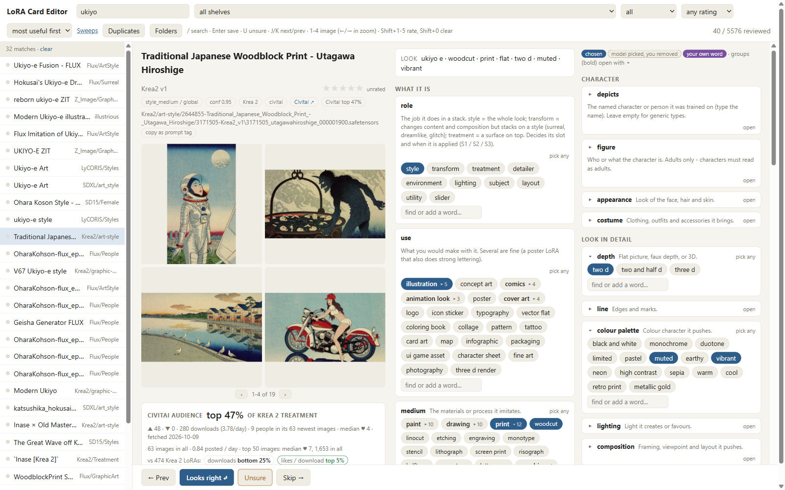

# Eric LoRA Catalog

**Find LoRAs by what they do, not by folder.** A local catalog of your LoRA library: a local vision LLM writes a
card for every LoRA (what it does, its role, style facets, genre and mood, trigger words, good weights, NSFW level),
you correct the cards in a fast browser editor, and the **LoRA Suggester** node picks LoRAs for a prompt from it.

- **Card editor** (browser): search everything, filter, rate, fix cards, move / rename / de-duplicate files with undo.
- **Civitai audience data**: how people rate each LoRA against others of its base model, the weights they actually
  use, the prompts they make with it.
- **LoRA Suggester** (ComfyUI node): reads your prompt (or a Wildcard Composer's sections) and stacks the LoRAs that
  fit, by role (style, treatment, detailer, lighting, subject ...) with per-stage weights and an NSFW gate.
- **ComfyUI sidebar panel**: refresh the catalog, card new LoRAs, open the editor, settings.
- **Works without ComfyUI** too (Forge, AUTOMATIC1111, SwarmUI, Invoke users): the catalog and editor are a
  standalone app; copy `<lora:name:weight>` tags from any card, or export Forge / A1111 sidecar files.



Status: **testing release** - feedback very welcome (see [Feedback](#feedback)).

## What you need

- **Python 3.12** (ComfyUI portable ships it in `python_embeded`). Older Pythons are not supported.
- **A local LLM server** that speaks the OpenAI API: [LM Studio](https://lmstudio.ai/) or
  [Ollama](https://ollama.com/) (llama.cpp server and vLLM work too), with
  - a **vision** model for the cards, e.g. Qwen3-VL 8B (about 6-8 GB VRAM at Q4) or Qwen2.5-VL 7B;
  - optionally a larger **text** model for genre and mood (any instruct model; blank = the vision model).

  A Qwen3 *text encoder* file you use inside ComfyUI workflows is not a chat server and cannot be used for this.
- **A Civitai API key** (optional but recommended: [civitai.com/user/account](https://civitai.com/user/account)) for
  model records, stats and example images. Without one only public records are fetched.
- Disk: the catalog is small (tens of MB per few thousand LoRAs); the Civitai cache and review pages add 100-300 MB.

## Install

### Inside ComfyUI

1. ComfyUI Manager → Install via Git URL: `https://github.com/EricRollei/Eric_LoRA_Catalog`, or:

   ```
   cd ComfyUI/custom_nodes
   git clone https://github.com/EricRollei/Eric_LoRA_Catalog
   ..\..\python_embeded\python.exe -m pip install -r Eric_LoRA_Catalog\requirements.txt
   ```
2. Restart ComfyUI. A **LoRA Catalog** tab appears in the left sidebar, and the **LoRA Suggester** node under
   *Eric Prompt Enhancers*.
3. In the sidebar tab open **Settings**: add your LoRA folder(s), pick the LLM server and models, paste your Civitai
   key, **Save**, then **Test LLM**.

Your data (catalog, cache, logs, your copies of the pick lists) goes to `ComfyUI/user/lora_catalog/`, not into the
node folder, so updating or reinstalling the node keeps it.

### Standalone (Forge, A1111, no ComfyUI)

```
git clone https://github.com/EricRollei/Eric_LoRA_Catalog
cd Eric_LoRA_Catalog
python -m pip install -r requirements.txt
copy settings.example.json settings.json      (cp on macOS / Linux) - then edit library_roots and the LLM
python run.py check
```

`launch.bat` / `launch.sh` open the card editor, `refresh.bat` / `refresh.sh` update the catalog. Data goes to
`user_data/` next to the code (set `data_dir` in `settings.json` to put it elsewhere).

## First catalog build

Inside ComfyUI: sidebar → **Refresh catalog**. Standalone: `refresh.bat` (or `python run.py refresh`).

The refresh runs eleven steps, each skipping what is already done, so it is safe to run any time - and it is what you
run again after adding LoRAs:

| # | step | what it does |
|---|---|---|
| 1 | index | new or changed LoRA files (headers, sidecars, LoRA Manager data) |
| 2 | hash | sha256 of files that have none yet |
| 3-7 | identify, crawl, creators, images, community | Civitai: versions by hash, records, creators, example images, audience data (internet; failures are skipped) |
| 8 | cards | the vision model writes a card for every LoRA without one |
| 9 | genre-mood | genre and mood for cards that have none (text model) |
| 10 | review-all | HTML review pages |
| 11 | facets | the table the LoRA Suggester reads |

Rough time on one GPU: indexing a few thousand files takes minutes; the Civitai steps a few seconds per LoRA; cards
3-10 s per LoRA (an 8B vision model, 3 in parallel) and genre-mood 2-6 s per LoRA. A first build of 1,000 LoRAs is
an evening; later refreshes only touch the new ones. Jobs started from the panel run in their own process - ComfyUI
keeps working and restarting it does not stop them - but a card pass and image generation share the GPU.

Then open the card editor (sidebar → **Open card editor**, or `launch.bat`) and go through the cards: Enter accepts,
fix what is wrong, rate what you like. Everything you change wins over the model's card from then on.

## LoRA Suggester (ComfyUI)

Inputs: a prompt as `text` (or a Wildcard Composer's `sections` from the
[video_prompter](https://github.com/EricRollei/video_prompter) pack). Outputs:

- `suggestions` → the **Eric Krea2 Multi-LoRA Stack** `suggestions` input ([Eric_Krea2](https://github.com/EricRollei/Eric_Krea2)): three-stage weights;
- `lora_text` → any loader that reads `<lora:name:weight>` tags (one weight per LoRA);
- `triggers`, `prompt_with_triggers`, `report` (what was picked and why, the runner-up per role, what was excluded).

Start in **suggest** mode (report only), switch to **apply** when you like what it picks. Hover any widget for help.
`exclude` / `pin` take names, `folder:`, `role:` and `axis:` entries. The `nsfw` gate decides what may be applied;
NSFW LoRAs are only used when the prompt itself asks for that content.

## Forge, AUTOMATIC1111 and other UIs

- **copy as prompt tag** on any card in the editor: `<lora:name:weight>` plus its trigger words.
- `python run.py export-sidecars --write`: writes the `<lora name>.json` files Forge and A1111 show in their LoRA
  browser (trigger words, preferred weight, description). Never touches a sidecar the tool did not write. Dry run
  without `--write`.

## What leaves your machine

- Calls to the **Civitai API** with your key: model and version records, stats, community image *metadata* (prompts,
  weights, reactions - usernames are hashed before storing), and example images saved next to your LoRAs.
- Calls to the **LLM server you configured** (normally on your own machine): the evidence for each card and up to two
  preview images.
- Nothing else. No telemetry, no accounts.

**NSFW**: every card gets a level (0 none, 1 suggestive, 2 nudity, 3 explicit) shown in the editor; filters and the
Suggester's gate use it. Thumbnails and example images are stored locally like any other.

## Settings

`settings.json` next to `run.py` (never in git; the panel writes it, or copy `settings.example.json`). Every key is
optional. The main ones: `library_roots`, `llm_base_url`, `card_model`, `genre_model`, `civitai_api_key` (or the
`CIVITAI_API_KEY` environment variable), `data_dir`. All keys are described in
[`lora_catalog/config.py`](lora_catalog/config.py). `python run.py check` shows what the tool sees.

## Known limits

- Cards are as good as the vision model; review the ones you care about (the editor's queue puts uncertain ones first).
- Civitai data needs the LoRA to be on Civitai (found by its hash); self-trained LoRAs get cards from their training
  captions instead.
- Sweeps (testing LoRA pairs by rendering) need the Eric_Krea2 nodes.
- The Suggester's platform list knows the common base models by folder name and Civitai base model; add your own under
  `"suggest": {"platforms": ...}` in `settings.json`.
- Windows is what it is developed on; macOS / Linux should work (the code avoids Windows-only calls) but are less tested.

## Feedback

Please open an issue with the **Feedback** template: OS, GPU, LLM server + models, how many LoRAs, what happened. The
sidebar's log view (or `<data folder>/logs/refresh.log`) helps a lot.

## More

- [docs/USER_GUIDE.md](docs/USER_GUIDE.md) - the editor, search and folders, Civitai data, genre and mood, sweeps,
  sliders, every command.
- [docs/design/](docs/design/) - design notes.

## License

Dual license: free for non-commercial use under CC BY-NC 4.0; commercial use needs a license. See [LICENSE](LICENSE).
(c) Eric Hiss ([@EricRollei](https://github.com/EricRollei)).
