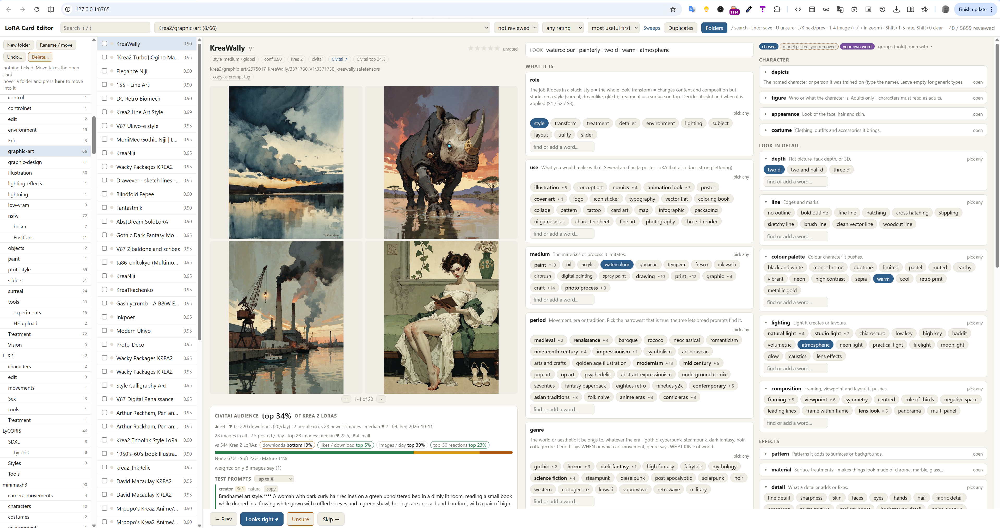

# Eric LoRA Catalog

**Find LoRAs by what they do, not by folder.** A local catalog of your LoRA library: a local vision LLM writes a
card for every LoRA (what it does, its role, style facets, genre and mood, trigger words, good weights, NSFW level),
you correct the cards in a fast browser editor, and the **LoRA Suggester** node picks LoRAs for a prompt from it.

- **Card editor** (browser): search everything, filter, rate, fix cards, move / rename / de-duplicate files with undo.
- **Civitai audience data**: how people rate each LoRA against others of its base model, the weights they actually
  use, the prompts they make with it.
- **LoRA Suggester** (ComfyUI node): reads your prompt (or a Wildcard Composer's sections) and stacks the LoRAs that
  fit, by role (style, treatment, detailer, lighting, subject ...) with per-stage weights and an NSFW gate.
- **ComfyUI sidebar panel**: refresh the catalog, card new LoRAs, open the editor, settings.
- **Works without ComfyUI** too (Forge, AUTOMATIC1111, SwarmUI, Invoke users): the catalog and editor are a
  standalone app; copy `<lora:name:weight>` tags from any card, or export Forge / A1111 sidecar files.



Status: **testing release** - feedback very welcome (see [Feedback](#feedback)).

## What you need

- **Python 3.12** (ComfyUI portable ships it in `python_embeded`). Older Pythons are not supported.
- **A local LLM server** that speaks the OpenAI API: [LM Studio](https://lmstudio.ai/) or
  [Ollama](https://ollama.com/) (llama.cpp server and vLLM work too), with
  - a **vision** model for the cards, e.g. Qwen3-VL 8B (about 6-8 GB VRAM at Q4) or Qwen2.5-VL 7B;
  - optionally a larger **text** model for genre and mood (any instruct model; blank = the vision model).

  A Qwen3 *text encoder* file you use inside ComfyUI workflows is not a chat server and cannot be used for this.
- **A Civitai API key** (optional but recommended: [civitai.com/user/account](https://civitai.com/user/account)) for
  model records, stats and example images. Without one only public records are fetched.
- Disk: the catalog is small (tens of MB per few thousand LoRAs); the Civitai cache and review pages add 100-300 MB.

## Install

### Inside ComfyUI

1. ComfyUI Manager → Install via Git URL: `https://github.com/EricRollei/Eric_LoRA_Catalog`, or:

   ```
   cd ComfyUI/custom_nodes
   git clone https://github.com/EricRollei/Eric_LoRA_Catalog
   ..\..\python_embeded\python.exe -m pip install -r Eric_LoRA_Catalog\requirements.txt
   ```
2. Restart ComfyUI. A **LoRA Catalog** tab appears in the left sidebar, and the **LoRA Suggester** node under
   *Eric Prompt Enhancers*.
3. In the sidebar tab open **Settings**: add your LoRA folder(s), pick the LLM server and models, paste your Civitai
   key, **Save**, then **Test LLM**.

Your data (catalog, cache, logs, your copies of the pick lists) goes to `ComfyUI/user/lora_catalog/`, not into the
node folder, so updating or reinstalling the node keeps it.

### Standalone (Forge, A1111, no ComfyUI)

```
git clone https://github.com/EricRollei/Eric_LoRA_Catalog
cd Eric_LoRA_Catalog
python -m pip install -r requirements.txt
copy settings.example.json settings.json      (cp on macOS / Linux) - then edit library_roots and the LLM
python run.py check
```

`launch.bat` / `launch.sh` open the card editor, `refresh.bat` / `refresh.sh` update the catalog. Data goes to
`user_data/` next to the code (set `data_dir` in `settings.json` to put it elsewhere).

## First catalog build

Inside ComfyUI: sidebar → **Refresh catalog**. Standalone: `refresh.bat` (or `python run.py refresh`).

The refresh runs these steps, each skipping what is already done, so it is safe to run any time - and it is what you
run again after adding LoRAs:

| # | step | what it does |
|---|---|---|
| 1 | index | new or changed LoRA files (headers, sidecars, LoRA Manager data) |
| 2 | hash | sha256 of files that have none yet |
| 3-7 | identify, crawl, creators, images, community | Civitai: versions by hash, records, creators, example images, audience data - including which other LoRAs each fetched image used (internet; failures are skipped) |
| 7b | pairs | which LoRAs people stack together, counted from those images (offline; optional - a failure never stops the run) |
| 8 | cards | the vision model writes a card for every LoRA without one |
| 9 | genre-mood | genre and mood for cards that have none (text model) |
| 9b | triggers | trigger recipes for new LoRAs or changed evidence, on the shelves in `trigger_arches` (default Krea2; text model; optional) - see [docs/TRIGGERS.md](docs/TRIGGERS.md) |
| 10 | review-all | HTML review pages |
| 11 | facets | the table the LoRA Suggester reads |
| 12 | style | CSD style vectors from preview images (optional: only with `style_enabled`; see the [user guide](docs/USER_GUIDE.md#style-vectors-csd-search-by-look)) |

Rough time on one GPU: indexing a few thousand files takes minutes; the Civitai steps a few seconds per LoRA; cards
3-10 s per LoRA (an 8B vision model, 3 in parallel) and genre-mood 2-6 s per LoRA. A first build of 1,000 LoRAs is
an evening; later refreshes only touch the new ones. Jobs started from the panel run in their own process - ComfyUI
keeps working and restarting it does not stop them - but a card pass and image generation share the GPU.

Then open the card editor (sidebar → **Open card editor**, or `launch.bat`) and go through the cards: Enter accepts,
fix what is wrong, rate what you like. Everything you change wins over the model's card from then on.

### LLM server notes (read this if cards time out)

A card request carries 2 preview images, up to 7,000 characters of evidence and a JSON schema, and needs about
**8,192 tokens of context** - far more than **Test LLM**, which sends one tiny image. So the test can pass while
every card times out. The two usual causes:

- **The model spills out of VRAM.** If ComfyUI (or anything else) holds the GPU, the server loads part of the
  model on the CPU, and image requests become very slow. Unload ComfyUI's models first, or run `refresh.bat` with
  ComfyUI closed.
- **The context is too small.**

**Ollama:** set the environment variable `OLLAMA_CONTEXT_LENGTH=16384` and restart Ollama (its default context is
smaller, and the OpenAI-style API cannot raise it per request). `ollama ps` shows where the model sits - the
PROCESSOR column should read *100% GPU*. The refresh sends 1 card request at a time on Ollama; the card pass and
**Test LLM** warn when the model is partly on the CPU or its context is too small.

**LM Studio:** load the vision model with a 16384 context (`lms load <model> --context-length 16384`, or in the
model's load settings) and full GPU offload. The refresh sends 3 card requests at once here; if they time out or
report "context size has been exceeded", run `refresh.bat --workers 1`.

To time a single card: `python run.py cards --limit 1`.

## LoRA Suggester (ComfyUI)

Inputs: a prompt as `text` (or a Wildcard Composer's `sections` from the
[video_prompter](https://github.com/EricRollei/video_prompter) pack). Outputs:

- `suggestions` → the **Eric Krea2 Multi-LoRA Stack** `suggestions` input ([Eric_Krea2](https://github.com/EricRollei/Eric_Krea2)): three-stage weights;
- `lora_text` → any loader that reads `<lora:name:weight>` tags (one weight per LoRA);
- `triggers`, `prompt_with_triggers`, `report` (what was picked and why, the runner-up per role, what was excluded).

Your sweep ratings move its picks: well-rated LoRAs up, and LoRAs that stacked well with what it already
chose up too (see [Your sweep ratings](#your-sweep-ratings-scores-stacks-and-partners)).
Start in **suggest** mode (report only), switch to **apply** when you like what it picks. Hover any widget for help.
`exclude` / `pin` take names, `folder:`, `role:` and `axis:` entries. The `nsfw` gate decides what may be applied;
NSFW LoRAs are only used when the prompt itself asks for that content.

## Search by look: style vectors

Words describe what a LoRA is *about*; they are poor at what it *looks like*. So the catalog can also describe each
LoRA by its look - optional, off until you set it up (below).

**How it works.** A style model, **CSD** (Contrastive Style Descriptors, Somepalli et al., ECCV 2024 - a CLIP ViT-L/14
fine-tuned so that images in the same style land close together *whatever they show*), turns every image into 768
numbers: its style vector. Each LoRA gets one from its Civitai preview images (up to 12, averaged). Two vectors are
compared by cosine: 1 = the same look, about 0.1 = unrelated. A LoRA's previews usually agree with each other at about
0.5 and with other LoRAs' previews at about 0.1, which is why no test rendering is needed. Strong on look LoRAs
(style, medium, photo look, lighting): two Mignola LoRAs match at 0.87, Frazetta sits with Vallejo and Brom. Weak on
photoreal LoRAs, which all look like "a realistic photo" to it - so look features only use look-type cards.

**Search by image.** Click **By image** in the editor, or drop or paste an image onto the search box:
1. the image becomes a style vector (the first search loads the model, about 15 s);
2. the list fills with your LoRAs closest in look, up to 200 - inside the current filters, so pick the base model
   first (Krea2 - all folders = Krea2 LoRAs only);
3. if the image carries generation metadata (ComfyUI, A1111 / Forge, Civitai), a **made with** line names the LoRAs
   it used - yours open in the editor, others link to Civitai. A pasted screenshot has no metadata; save or download
   the file instead.
It matches **style, not subject**: a watercolour fox finds watercolour LoRAs, not fox LoRAs.

**Also uses it:** the **Similar look** strip on every card, **Look-alikes** (near-copies of one look, for culling),
the LoRA Suggester's `style_image` input, and render checks of sweep cells. Setup and details:
[user guide](docs/USER_GUIDE.md#style-vectors-csd-search-by-look).

    python run.py style-setup            download the CSD weights (2.4 GB, kept as 1.2 GB)
    settings.json: "style_enabled": true
    python run.py style                  vectors for every LoRA (GPU ~80 images/s, once; then only new previews)

## Your sweep ratings: scores, stacks and partners

Sweeps from the [Eric_Krea2](https://github.com/EricRollei/Eric_Krea2) nodes write a review workbook. Rate the cells
there (or on the **Sweeps** page), then press **import** on that sweep in the Sweeps page: every rated cell becomes a
mark with its checkpoint, prompt, weight, word mode and every LoRA in it.

- **Per LoRA.** A model separates how good each LoRA is from how hard the prompt was and how the checkpoint behaves
  (baseline cells without LoRAs measure that), and is cautious until enough ratings back it. A stack cell counts toward
  each of its LoRAs at 1/n. The card's **Sweep record** shows the result split by checkpoint, prompt type, subject,
  weight, alone vs in a stack, and flaw / praise tags; the header shows **sweeps 3.8&#9733; &middot; 12** (the mean of
  your starred marks) next to your own card stars, which stay yours to set.
- **Per pair (stack synergy, 2026-10-27).** Every rated stack is compared with what its LoRAs predict on their own for
  that prompt and checkpoint. The difference is the pair's **synergy**: + = better together than apart, - = worse.
  It is shrunk toward zero until several stacks back it and refitted whenever you mark. Most reliable when the LoRAs
  were also rated alone (sweep `stack_parts` "each LoRA alone").
- **On the card:** *Pairs well with (your stacks)* - synergy, stack stars vs expected, marks; *Worse together*; and
  *Others stack it with (Civitai)* - from `run.py harvest`, other users' stacks, popularity rather than your taste.
- **In the LoRA Suggester:** once a pair has 2+ rated stacks, the Suggester reorders its picks by your synergy with what
  it already chose (pins included) - pin a LoRA and its good partners move up, bad ones down, with a reason line in the
  report. It reorders only; scores are not changed.
- **In Eric_Krea2 sweeps:** a stack line can ask for a proven partner - `random: catalog comic x4 | partner: best` -
  your best-rated partner of the first LoRA, else what Civitai users stack it with (owned only).

## Discover: LoRAs you don't own

**Discover** (editor header) lists LoRAs you do not have, ranked by how often other people use them **in the same
image** as LoRAs you own - counted by distinct people, from the Civitai images gathered by the stack harvest - and by
how much you like those LoRAs of yours:

- each LoRA of yours counts by your rating of it: your 4-5 star LoRAs pull hardest, unrated ones count normally,
  ones you rated far below your average (-1.5 stars or worse) not at all;
- Civitai's community score (approval, likes per download, downloads per day) nudges the order, 0.5x to 1.5x;
  popularity never leads;
- only for the base model of the **shelf you have selected** (Krea2 selected = Krea2 LoRAs; the Civitai names
  "Krea 2" / "Krea 2 Turbo" are matched automatically, or set `"discover_bases": {"Krea2": ["Krea 2", "Krea 2 Turbo"]}`
  in settings.json).

Pick one to see why it is suggested: the LoRAs of yours it is used with (your rating, how many people, how much more
often than chance), the weight people give it, example images, and buttons **Open on Civitai**, **Copy version id**
(for the downloader) and **Not interested** (hides it here and from `run.py pairs --wishlist`; undo right away). A
LoRA you already have in another version is labelled and listed last. J / K or arrows move, Esc goes back to your
cards.

It is only as fresh as the harvest:

    python run.py harvest --only Krea2      community images of your Krea2 LoRAs (resumable)
    python run.py pairs                     recount who uses what together
    python run.py pairs --wishlist          the same list on the command line (--no-taste: ignore your ratings)

A shelf with nothing harvested shows an empty list with those two commands.

## Prompt library

Every prompt the catalog collects - your LoRAs' preview prompts and the Civitai community prompts made with them -
goes into one deduplicated library you can filter and export. On this author's catalog: **70,437 different prompts**
from 123,385 images (Krea 2: about 13,000), built in under a minute.

    python run.py prompts build      merge new prompts in (also automatic: end of run.py refresh, after run.py community)
    python run.py prompts stats      counts by NSFW level, style, source, base model
    python run.py prompts export --base Krea --style natural --max-nsfw R --min-reactions 20 --out D:\prompts\krea2.txt

- **Where:** `prompt_library_dir` (default: a `prompts` folder beside the folder holding the catalog, e.g.
  `L:\Models\prompts\_prompt_library.sqlite`). Exports go there too unless you give `--out`.
- **One prompt, many images:** the same prompt (any spacing, capitals or `<lora:...>` tags) is one entry that counts
  every image it was used for, with its best reactions and worst NSFW level.
- **Triggers stripped:** each LoRA's trigger words (of the LoRA it came with and of every other LoRA of yours that image
  used) are removed, so the prompts work without them and nothing is left to show up as text in an image. What was
  removed, and which LoRAs and weights the image used, is kept; `--with-triggers` exports the original wording. A
  "trigger" that is an ordinary prompt word (watercolor, woman ...) is left in.
- **NSFW:** Civitai's scale, `--max-nsfw PG | PG-13 | R | X | XXX` (default X), judged by the worst image a prompt was
  used for; `--clean-text` also drops prompts whose words mention nudity. Older Civitai data says only "X" for both X and
  XXX; prompts collected from now on carry the exact level.
- **Filters:** `--base`, `--min-reactions`, `--lora-rating N` (came with a LoRA you rated N stars or more: card stars,
  else your sweep marks), `--style natural|tags`, `--facet medium=watercolour` / `--facet period="art nouveau"` (the
  look of the LoRA it came with, repeatable; a value alone, `--facet surreal`, matches any facet), `--text surreal` (the prompt itself contains the word or phrase; repeatable, all must appear), `--min-words` / `--max-words`, `--source preview|community`, `--top N` with `--order likes|newest` (the first N by community likes, or the most recently posted),
  `--sample N --seed S`.
- **Formats:** `txt` (one prompt per line - ready for the Eric_Krea2 Sweep Plan: `random: L:\Models\prompts\krea2.txt
  x20`), `jsonl` / `csv` (every field: original, triggers removed, LoRAs, facets ...), `sqlite`. `--split-by medium`
  writes one file per value into the `--out` folder.
- **LLM rewrite (optional):** `--rewrite tidy` (tag lists become sentences, quality tags and weights go, nothing added),
  `--rewrite krea2` (restructured with the Eric_Krea2 Magic Prompt expander's system prompt), `--rewrite expand` (only
  prompts under `--expand-under` words). Uses the catalog's local LLM server and `prompt_model` (blank: genre_model).
  Rewrites are cached and reused; more than 200 new ones ask first (`--yes`). `--system-prompt FILE` uses your own.

Community prompts are other people's public posts: the library is for your own use and is not part of this repo.
Design: [docs/design/PROMPT_LIBRARY.md](docs/design/PROMPT_LIBRARY.md).

## Trigger words: what a LoRA needs in the prompt

`python run.py triggers` writes a **prompt recipe** per LoRA from its Civitai trained words, the model page (the
"use this / add that" advice the API does not return), the creator's example prompts and the prompts people used with
it: a trigger, a short style phrase, setting hints and words to avoid. A trigger-test sweep (Eric_Krea2) then measures
which variant - nothing, the trigger, the official words, trigger + phrase - the LoRA actually needs.

The first test (5 LoRAs, 3 checkpoints, Oct 2026) found that **the checkpoint decides**: on the base Krea 2 turbo
model the LoRAs needed little - some showed their look with no words, the bare trigger did a lot - while on
fine-tuned checkpoints they needed their descriptive words and the bare trigger token did almost nothing. Lean
stacks on the base model, fuller trigger text on fine-tunes. Details, the full table and the commands: [docs/TRIGGERS.md](docs/TRIGGERS.md).

## Forge, AUTOMATIC1111 and other UIs

- **copy as prompt tag** on any card in the editor: `<lora:name:weight>` plus its trigger words. **copy name**
  (2026-10-16) copies just the file name: paste it into the Krea2 Multi-LoRA Stack (its *Paste LoRA* button, or the
  slot search), a sweep's `lora_files`, or a prompt tag.
- The editor opens on the folder and status set in settings.json: `editor_start_shelf` (default `Krea2`, every
  Krea2 folder; the shelf picker now has a *- all folders* entry per base model) and `editor_start_status`
  (default `all`).
- `python run.py export-sidecars --write`: writes the `<lora name>.json` files Forge and A1111 show in their LoRA
  browser (trigger words, preferred weight, description). Never touches a sidecar the tool did not write. Dry run
  without `--write`.
- `python run.py prune-orphans --apply`: after deleting or moving LoRA files by hand, removes the cards, slider
  cards, style vectors and trigger rows left behind for files no longer indexed (backs up the catalog first; your
  own edits, marked stacks and the move log are kept). Dry run without `--apply`.

## What leaves your machine

- Calls to the **Civitai API** with your key: model and version records, stats, community image *metadata* (prompts,
  weights, reactions - usernames are hashed before storing), and example images saved next to your LoRAs.
- Calls to the **LLM server you configured** (normally on your own machine): the evidence for each card and up to two
  preview images.
- Nothing else. No telemetry, no accounts.

**NSFW**: every card gets a level (0 none, 1 suggestive, 2 nudity, 3 explicit) shown in the editor; filters and the
Suggester's gate use it. Thumbnails and example images are stored locally like any other.

## Settings

`settings.json` next to `run.py` (never in git; the panel writes it, or copy `settings.example.json`). Every key is
optional. The main ones: `library_roots`, `llm_base_url`, `card_model`, `genre_model`, `civitai_api_key` (or the
`CIVITAI_API_KEY` environment variable), `data_dir`. All keys are described in
[`lora_catalog/config.py`](lora_catalog/config.py). `python run.py check` shows what the tool sees.

## Known limits

- Cards are as good as the vision model; review the ones you care about (the editor's queue puts uncertain ones first).
- Civitai data needs the LoRA to be on Civitai (found by its hash); self-trained LoRAs get cards from their training
  captions instead.
- Sweeps (testing LoRA pairs by rendering) need the Eric_Krea2 nodes. Their Sweeps page rates the cells and makes
  labelled share sheets for posting (creators and Civitai numbers credited, your stars optional).
- The Suggester's platform list knows the common base models by folder name and Civitai base model; add your own under
  `"suggest": {"platforms": ...}` in `settings.json`.
- Windows is what it is developed on; macOS / Linux should work (the code avoids Windows-only calls) but are less tested.

## Feedback

Please open an issue with the **Feedback** template: OS, GPU, LLM server + models, how many LoRAs, what happened. The
sidebar's log view (or `<data folder>/logs/refresh.log`) helps a lot.

## More

- [docs/USER_GUIDE.md](docs/USER_GUIDE.md) - the editor, search and folders, Civitai data, genre and mood, style
  vectors (CSD: search by look, render checks), sweeps, sliders, every command.
- [docs/TRIGGERS.md](docs/TRIGGERS.md) - trigger recipes, what the trigger tests found, and picking each LoRA's
  prompt words (per card or per checkpoint) for Eric_Krea2's `recipe` trigger mode.
- [docs/IMPROVING_CARDS.md](docs/IMPROVING_CARDS.md) - every layer that makes cards and Suggester picks better:
  built, being tested, planned.
- [docs/design/](docs/design/) - design notes.

## License

Dual license: free for non-commercial use under CC BY-NC 4.0; commercial use needs a license. See [LICENSE](LICENSE).
(c) Eric Hiss ([@EricRollei](https://github.com/EricRollei)).
